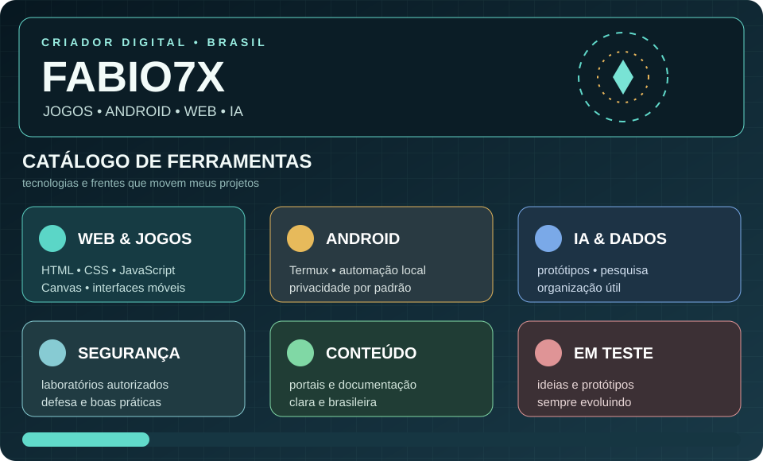

# Fabio7X

> Projetos independentes feitos no Brasil, com foco em celular, criação e evolução real.

## O que você encontra aqui

**Jogos e web** para experiências leves e mobile-first.  
**Android e Termux** para ferramentas locais e automação prática.  
**IA e dados** para pesquisa, protótipos e organização.  
**Segurança defensiva** para estudo somente em ambientes autorizados.  
**Conteúdo** para documentação e projetos da Fris Black Estúdio.

---

### Princípios de construção

- **Mobile-first:** uso bom mesmo sem PC.
- **Clareza:** projetos e documentação diretos.
- **Privacidade:** acesso e dados só quando fazem sentido.
- **Teste contínuo:** criar, testar, ajustar e melhorar.

`STATUS: laboratório criativo ativo`