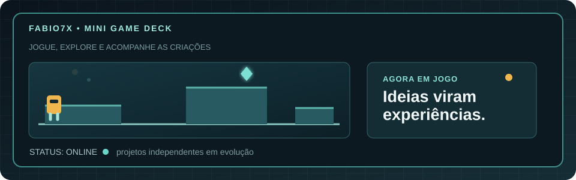

# Fabio7X

> Projetos mobile-first, Android, web e jogos em português.

Sou Fabio, criador de experiências para celular: minijogos de navegador, ferramentas locais, sites e documentação acessível. Meu foco é construir coisas claras, testáveis e boas de usar.

## 🎮 Em criação

Uma vitrine animada de projetos, jogos e experiências feitas para celular.

## Em foco

- Aplicativos Android e automação local com privacidade
- Sites e experiências web que funcionam bem no celular
- IA aplicada a organização, protótipos e criação
- Segurança defensiva em ambientes autorizados

## Projetos selecionados

| Projeto | Descrição |
| --- | --- |
| Ponto de IA | Painel mobile-first para organizar tarefas, fontes, prompts e decisões. |
| Termux Dev Toolkit | Scripts e utilitários para Termux e Linux. |
| Guia Hacking Ético | Curadoria de segurança defensiva em português. |
| Coroa Viva | Guia local de Coroa Vermelha e Porto Seguro. |
| Brasil em Pauta Comunidade | Espaço público de sugestões para o portal da Fris Black Estúdio. |

## Princípios

- **Mobile-first:** feito para usar bem sem PC.
- **Clareza:** interface e documentação sem enrolação.
- **Privacidade:** dados e permissões só quando necessários.
- **Segurança responsável:** estudos e testes somente com autorização.
- **Evolução real:** testar, corrigir e melhorar em cada versão.

---

Projetos independentes, feitos no Brasil e em evolução contínua.